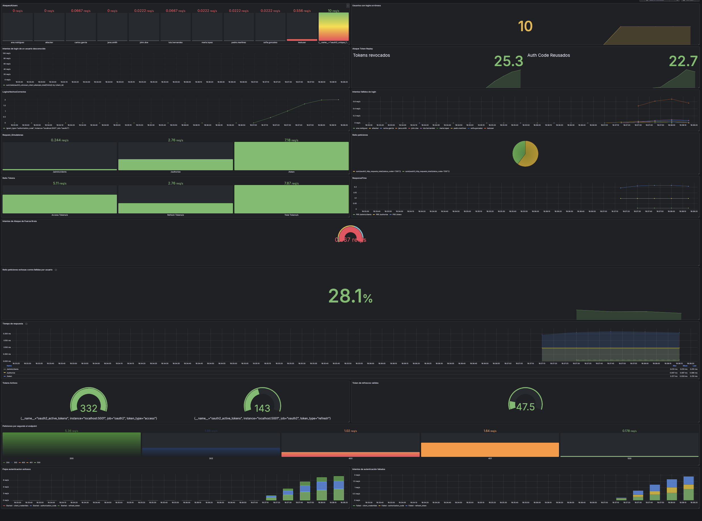
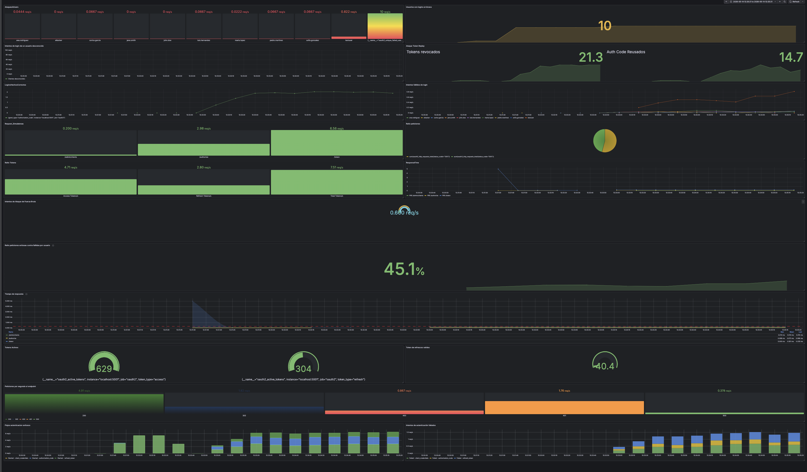

# 🛡️ OAuth2 EDR & Load Testing (Prometheus + Locust)

Este proyecto implementa un sistema de monitorización avanzada y pruebas de carga sobre un servidor de autenticación **OAuth2** (escrito en Python/Flask). 

El objetivo principal ha sido instrumentar el código base para exponer métricas en tiempo real, simular tráfico legítimo y malicioso mediante pruebas de estrés, y construir un panel de control **EDR (Endpoint Detection and Response)** en Grafana capaz de detectar ataques y cuellos de botella.

## 🚀 Tecnologías Utilizadas
*   **Backend:** Python 3.10, Flask, SQLite (Gestión de paquetes con `uv`).
*   **Monitorización:** Prometheus (Base de datos de series temporales *Pull*).
*   **Visualización:** Grafana (Dashboards interactivos mediante *PromQL*).
*   **Pruebas de Carga:** Locust (Simulación de usuarios concurrentes y flujos de tráfico).

## 📁 Estructura del Proyecto

El código fuente ha sido organizado separando la lógica de la aplicación, la infraestructura de pruebas y la documentación:

*   **`P1/`** — *Histórico de la asignatura, entrega de la práctica 1*

*   **`src/`** — *Núcleo del servidor OAuth2 y monitorización*
    *   `app.py`: Punto de entrada de la aplicación Flask. Configura la base de datos, registra los *blueprints* e inyecta los decoradores (`@before_request`, `@after_request`) para la recolección automática de métricas HTTP y la exposición del endpoint `/metrics` mediante *DispatcherMiddleware*.
    *   `metrics.py`: Definición centralizada de todas las métricas de Prometheus (Counters, Gauges, Histograms) orientadas tanto a rendimiento como a seguridad (EDR).
    *   `models.py`: Capa de acceso a datos (SQLite). Gestiona el ciclo de vida de clientes, códigos de autorización y tokens, disparando métricas clave de seguridad (ej. `auth_code_reuse`, `revoked_token_usage`) al detectar anomalías.
    *   `oauth2_routes.py`: Implementación de los endpoints principales (`/authorize`, `/token`). Maneja los flujos *Authorization Code*, *Client Credentials* y *Refresh Token*, registrando los intentos de fuerza bruta y *credential stuffing*.
    *   `admin_routes.py`: Endpoints de administración interna (`/admin/clients`) para el registro y borrado de clientes OAuth2.

*   **`tests/`** — *Simulación de carga y validación*
    *   `locustfile.py`: Script de pruebas de estrés para Locust. Define los perfiles de usuarios virtuales, orquestando el tráfico legítimo y los ataques (fuerza bruta, recolección de tokens, enumeración de clientes, etc.).
    *   `test.py`: Script de verificación secuencial automatizada. Simula los 12 escenarios de prueba y comprueba mediante aserciones directas al endpoint `/metrics` que Prometheus registra correctamente cada evento de seguridad.

*   **`docs/`** — *Documentación del proyecto*
    *   Contiene la memoria técnica detallada (`ESI_P2_G16.pdf`) y las diapositivas de la presentación final (`Presentacion.pdf`).

*   **Raíz del proyecto**
    *   `prometheus.yml`: Archivo de configuración del servidor Prometheus. Define los intervalos de *scrapeo* (15s) y el objetivo (`localhost:5001`).

## 🔍 Instrumentación y Enfoque EDR
El servidor ha sido modificado siguiendo el principio DRY (centralizando los contadores en `metrics.py` e inyectando decoradores de *middleware* en `app.py`). Se han implementado métricas clave para la seguridad:

*   **Detección de Fuerza Bruta y Credential Stuffing:** Monitorización de intentos fallidos por `client_id` y `username`.
*   **Prevención de Token Replay:** Seguimiento de códigos de autorización pendientes y detección de intentos de uso de *Refresh Tokens* revocados o expirados.
*   **Rendimiento y Saturación:** Histogramas del tiempo de respuesta (Percentil 95) y medidores (gauges) de peticiones HTTP en curso para detectar posibles ataques DoS.

## ⚡ Diseño de Pruebas (Locust)
Se diseñó un `locustfile.py` realista que distribuye el tráfico en tres categorías simulando un entorno de producción:
*   **50% Tráfico Legítimo:** Flujos M2M (*Client Credentials*), autenticaciones web (*Authorization Code*) y rotación de *Refresh Tokens*.
*   **45% Tráfico Malicioso (Ataques):** Inyección controlada de fuerza bruta a APIs, recolección de tokens (*Token Harvesting*), enumeración de clientes y reutilización de códigos interceptados.
*   **5% Monitorización:** Peticiones a endpoints de administración interna.

### Resultados del Análisis de Estrés
Durante las pruebas de estrés escalonadas (de 10 a 200 usuarios concurrentes), se identificó un **cuello de botella de concurrencia** en el servidor de desarrollo de Flask (límite operativo estable: ~10 usuarios concurrentes / 12 RPS antes de degradar el SLA de 250ms), causado por la ejecución síncrona monohilo durante las operaciones criptográficas de los tokens. El dashboard EDR diferenció exitosamente los falsos positivos de los ataques reales de *Credential Stuffing*.

## 📂 Documentación
*   📄 **[Memoria Técnica Completa (PDF)](./docs/ESI_P2_G16.pdf)**: Análisis detallado de las métricas PromQL, capturas del dashboard y flujos de ejecución.
*   📊 **[Presentación del Proyecto (PDF)](./docs/Presentacion.pdf)**.

## 👥 Autores
Desarrollado como proyecto de la asignatura *Evaluación de Sistemas Informáticos* (Universidad de Valladolid) por el Grupo 16:
*   Álvaro López Primo
*   Edgar Santiesteban Mendo
*   Marcos Álvarez Fulconis